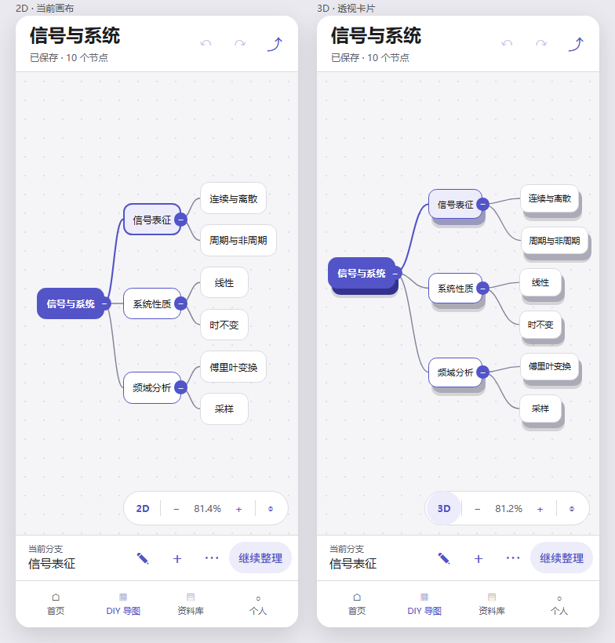

# DIY 2D / 3D 设计预览

## 交互预览

双击 [diy-preview.html](diy-preview.html) 在浏览器中打开。页面内可以：

- 点击 `2D / 3D` 切换平面画布和分层卡片画布；
- 拖动画布平移、滚轮缩放、点 `◎` 适应画布；
- 点击节点选中，点击节点右侧 `− / +N` 折叠或展开分支；
- 切换向右/向下布局，观察两种视图的重新排布。

这张图由当前 `MapLayout.ets` 的布局与 `MindMapCanvas.ets` 的 3D 投影参数在 Node 中计算后绘制，用于对照 2D 和 3D 的视觉差异。**它不是鸿蒙 SDK Previewer 或真机截图，不能作为设备验收证据**；外壳（标题栏、底栏、导航）只是等尺寸示意。生成脚本未随仓库提交，投影数值以源码为准。

- 左：2D，节点保持平面布局，选中分支整条高亮。
- 右：3D，卡片按层级缩小、向右下错层，并带底部/右侧厚度与投影；选中路径仍用强调色。
- 3D 的卡片位置只保留 2D 树间距并叠加层级位移，避免连线折返或同层重叠。
- 真机上的字体实绘、触控命中、双指缩放、深色和软键盘仍需按 [DIY 设计说明](../implementation/diy-design.md) 补测。
