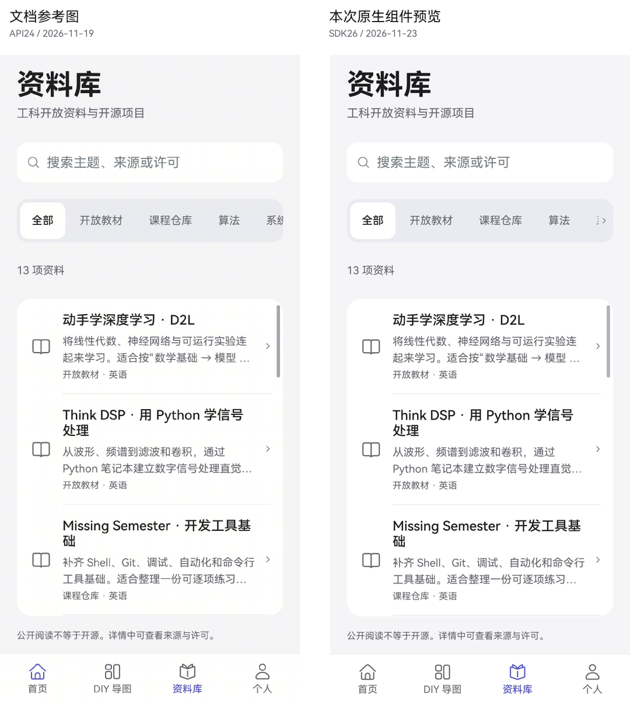
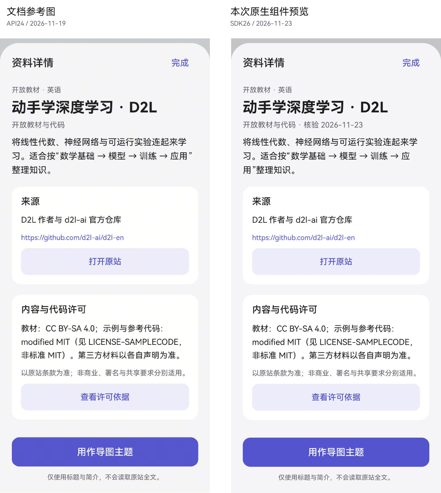
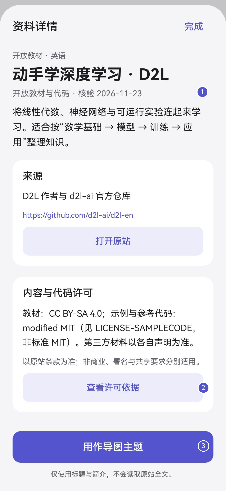

# 陈珂睿 · 资料库交付与自测记录

日期：2026-11-23。基线：`e2d1d1e2bf83e576b2bd2cc27f9b0d0d634bc1f2`。目标工程：[mzk-C4/FlowSpace-harmony](https://github.com/mzk-C4/FlowSpace-harmony)。

## 交付状态

已完成资料库页面维护、13 项资料与许可复核、原生组件筛选/详情截图、输入/回调说明和自测记录。完整工程已构建 unsigned HAP；未签名，不能直接当作手机可安装包。源码和截图不替代后续真机/真实模型验收。

## 页面与参考图的一致性

以分工文档第 11 页列表与第 12 页 D2L 详情为基准。保留 34fp 大标题、14fp 副标题、48vp 搜索、单行横向分类、白色分组列表、两行摘要、来源/许可分组和蓝紫主题按钮。正式底部导航继续由 Index 统一维护。

| Before | After | Why |
| --- | --- | --- |
| 分类右侧不明显可滑动 | 分类条右侧补小箭头与无障碍描述 | 保持同一行布局，提示还有选项 |
| 详情缺少逐项核验日期 | 类型行附核验日期 | 不增加卡片高度，不挤压底部操作 |
| 部分教材有两份许可 | “查看许可依据”内选择内容/代码许可 | 保留参考图的单一许可按钮 |
| 原站启动失败只在主页面报错 | 错误按资源 id 回传详情，给出重试和复制说明 | 避免详情弹层遮住反馈 |
| 搜索字段不一致、整串空格难匹配 | 原生与网页同步按多个关键词 AND 匹配标题、简介、来源、分类、类型、语言、许可、ID 和 URL | 同一目录、同一搜索规则 |
| Think DSP 代码授权未确认 | 阅读独立 LICENSE 后明确为 MIT | 与教材 CC BY-NC-SA 4.0 分别展示 |

参考图来自 API24 SDK / 2026-11-19。本轮为本机 SDK26.0.0.105 / 2026-11-23，工程 compatible/target 仍为 API24。字体与排版引擎造成少量换行差异；没有声称逐像素完全相同，也没有虚构视觉相似度百分比。

## 数字标注截图：问题—计划—结果

所有主屏/筛选/详情截图均为 1080×2340、480dpi（360×780vp）的 SDK 原生组件预览。实际组件为正式 LibraryPage；独立宿主仅隔离 Previewer 不能初始化的数据库，不替代全应用联调。底部导航外观沿用正式宿主，其余标签在该预览容器中不提供正式业务。

| 截图/标号 | 当前问题 | 计划调整 | 调整后结果 |
| --- | --- | --- | --- |
| 主屏 1 | 横向分类不够明显 | 加右侧箭头 | 仍为参考图的一行分类 |
| 主屏 2 | 长简介容易挤占卡片 | 保持两行截断 | 标题、两行简介、分类/语言的层级保留 |
| 主屏 3 | 容易将公开访问理解为开源 | 保留底部许可提示 | 详情提供具体许可依据 |
| 筛选 1 | 需要明确当前条件 | 维持选中标签 | 原生实点“开放教材”后选中态可见 |
| 筛选 2 | 无法判断命中数量和恢复方法 | 显示数量及重置 | 真实命中 2 项、重置可用 |
| 筛选 3 | 部分结果较少导致空白 | 保持分组列表容器 | 不复制假资料填充空白 |
| 详情 1 | 缺少逐项核验日期 | 放在已有类型行 | 不新增一块卡片 |
| 详情 2 | 教材/代码许可可能不同 | 许可按钮打开原生选择菜单 | D2L/Think DSP 分别有独立代码链接 |
| 详情 3 | 担心暗示已经读取原站全文 | 固定主题按钮和边界文字 | 回调也明确禁止声称读取全文 |

## 输入与回调

- `LibraryPage.onOpenResource(resource: LearningResource): void`：保留原合同，主页面按 `resource.url` 启动系统浏览器。许可依据的 id 为资源 id + `-license`；不能按主目录 id 过滤这些入口。
- `LibraryPage.onUseTopic(text: string): void`：保留原合同。关闭 Sheet 后只派发一次，由主页面进入现有真实生成流程；页面不直接访问模型、不抓取全文。
- 新增可选只读输入 `externalOpenError: string = ''`、`failedResourceId: string = ''`：主页面回传外部启动失败。无错误时页面外观不增加提示。失败仍保留详情、筛选和当前导图。
- `RESOURCE_VERIFICATION`：本模块补充记录，与共享 `LearningResource.id` 一一对应，不修改公共领域类型。
- `resourceTopic(resource)`：统一生成边界；`findOpenResources(query, category)`：同一分类内多词 AND 搜索。网页的目录和纯函数通过 `node tools/sync-library-preview.mjs` 从 ArkTS 同步。

## 已执行自测

| 项目 | 结果与边界 |
| --- | --- |
| 最终完整回归 | 116/116 通过；包含新增 10 项目录、搜索、原生事件、许可选择、主题回调、错误恢复和网页一致性用例 |
| 集成静态检查 | 通过：4 页面、18 个正式 ArkTS 文件、导入与双主题文字对比；不代替编译 |
| 完整原生构建 | DevEco SDK26.0.0.105、工程 API24 目标，assembleHap BUILD SUCCESSFUL；输出 unsigned HAP |
| 原生截图脚本 | 实际执行并成功输出主屏、开放教材筛选与 D2L 详情 |
| 浅色/深色 | 1080×2340 原生列表、筛选、详情已检查 |
| 小屏 | 960×1800（320×600vp）原生列表与详情已检查；详情正文可滚动，主题按钮保留在下方 |
| 13 项入口/许可 | 28/28 HTTP GET 200；另阅读官方许可与短许可证文件，不抓取正文 |
| 原生分类 | 实点“开放教材”，2 项命中、重置按钮、返回详情均有截图 |
| 搜索与无结果 | 执行正式目录和组件事件逻辑验证；未把脚本测试写成键盘实机通过 |
| 外部启动失败 | 实际 Index 方法在系统替身抛错时返回失败，成功重试清空旧错误；不是系统浏览器实测 |
| 主题生成 | 实际 LibraryPage 回调在 Sheet 收起后发送一次，Index 接入原生成流程；没有实际调用供应商 |

## 待设备验收，不预先勾选

1. 在具备本应用调试签名的 API24+ 手机安装，测试系统浏览器打开 13 项入口与许可页，以及原站移动端可读性。
2. 测试软键盘搜索、系统返回、大字、TalkBack/屏幕朗读和实际触控。
3. 配置真实模型后，从资料详情触发主题生成，确认得到真实候选且失败可恢复。模型网关归公共能力负责人维护。
4. 在纯 API24 SDK 和 API24 设备复核兼容性。本机 SDK26 构建暴露了原工程 Controls.fill/stroke 的 API26 兼容警告；未以这次构建宣称 API24 设备兼容已通过。现有存储/导出/生成模块也有异常处理与弃用提示，详见构建日志。

本轮没有修改公共类型、数据库、AI 网关或其他三个正式页面；Index 只增加资料库外部启动错误的回传与重试清理。

## 复现

Node 24+ 下运行 `node tools/check-integration.mjs` 和 `npm test`。macOS 原生截图见 `tools/library-preview/README.md`。Windows 的现有构建/真机脚本保持原样。源码、补丁、HAP、截图和核验记录均附本轮交付。
