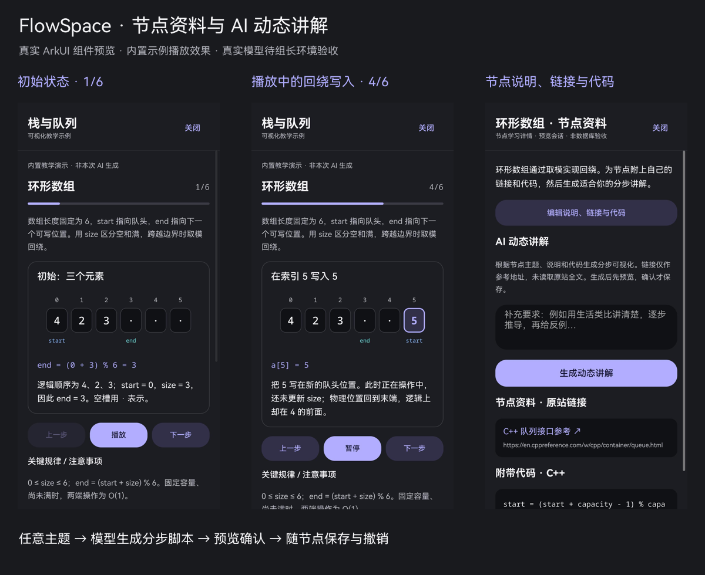

# 节点资料与任意主题 AI 动态讲解

2026-11-27；基于主仓库 `1b6f096`，在 `feature/node-learning-visualization-20261127` 开发，通过 PR 交付，不直接更新 main。

## 用户路径

1. 新增或选中导图节点，点节点工具栏的书本图标“节点资料与动态讲解”（更多菜单中也有入口）。
2. 独立学习详情页里编辑知识说明、最多8条 HTTPS 链接、代码语言与最多6000字代码；确认保存后沿用原节点编辑命令、自动保存和撤销。
3. 填写补充讲解要求，点“生成动态讲解”。网关调用组长配置的模型，根据任意节点主题/说明/代码编排2–12步可视化脚本。链接只有地址，不读取全文。
4. 查看 AI 候选、播放或手动切换步骤、检查代码高亮。点“应用并保存”才替换该节点的讲解；放弃、取消、失败和过期版本不覆盖原资料。
5. 在资料库点“知识动态讲解”看环形数组、队列、栈的内置示例。它们明确标记“非本次 AI 生成”。新增入口保留13项资料、分类、搜索与许可详情。

## 视觉与交互

独立页面采用用户参考图的知识标题、分步进度、描边卡片、当前状态、指针标签、步骤说明与逐行代码。深色跟随现有主题，白色主题也可用；数组短值在360vp手机上完整显示6格，长值允许横向滚动。start/end有不同颜色和文字，不只靠颜色区分。

每2.2秒推进一步，可播放/暂停/重播/上一步/下一步；离开页面清理定时器。减少动效开启时停播，保留手动切步。编辑表单离开有未保存确认，系统返回经现有 Navigation 处理。代码可复制，任何输入/AI代码仅展示，不执行。

AI可选择数组状态、栈、流程、对照四类视图。这里“任意主题”指按主题生成讲解内容与这些视图中的状态变化；不等于任意物理仿真、3D场景或自动运行代码。数学与非代码概念允许无代码，使用公式/关系/概念卡。

## 数据、版本与恢复

公共 MindMapNode 与数据库结构保持不变。附件登记在原 note 尾部 `flowspace-learning-v1` 围栏中，包括链接、代码、语言、讲解脚本；说明仍保留为前面的普通备注。普通节点备注编辑自动保留附件，AI导图修订也保留已确认的附件区块。资料必须经原编辑命令更新，revision递增，一次撤销可恢复。

JSON导出/恢复天然包含 note 与讲解；旧导图无区块时按普通备注处理。元数据损坏时明确报错，原文保留，不静默抹除。备注总长10000字，模型脚本最多8000字符；已有较长代码/说明可能让总量超限，应用时提示缩短，原资料保持。Markdown导出含原备注区块，暂未另做美化的讲解文稿导出。

生成响应绑定 requestId/documentId/nodeId/baseRevision。取消和离开页面后，迟到响应不恢复候选；版本变化后旧候选不能应用。保存状态沿用主页面，如数据库失败显示未保存并可在主页面重试。

## 模型接入

新增 `POST /api/lessons/generate`，复用服务端 `LLM_BASE_URL`、`LLM_MODEL`、`LLM_API_KEY`。组长已有key后只需在服务器原有环境配置中填好，不需要在页面、代码或GitHub放key。手机个人页仍只保存网关地址。网关与手机代码都必须使用本次分支版本（旧网关没有新接口，会404）。

服务端校验请求、模型输出、来源范围、指针索引、代码行与总长；失败修复一次。与导图生成共用并发锁和最多8个活跃请求限制，支持超时与断连取消。脚本只允许声明式数据，播放器按固定组件渲染。

## 代码位置

- `learning/NodeLearning.ets`：兼容旧note的编解码与链接校验。
- `learning/LessonScript.ets`：讲解类型与客户端校验。
- `learning/LessonCatalog.ets`：原创内置教学脚本。
- `learning/LessonPlayer.ets`：原生播放器。
- `learning/NodeLearningPage.ets`：链接/代码编辑与AI候选流程。
- `learning/LessonClient.ets`：带取消、响应版本核对的模型网关客户端。
- `pages/Index.ets`、`ui/DIYPage.ets`、`ui/LibraryPage.ets`：正式入口、Navigation与领域命令接入。
- `backend/lessons.mjs`：真实模型调用及讲解协议；`backend/node-study.mjs`：导图修订时保留附件。
- `docs/preview/learning-ui.js`、`tools/sync-learning-preview.mjs`：网页学习页，原生schema和示例同步内嵌，无新增运行依赖。

## 已验证与边界

最终完整回归 **152/152 通过**，静态集成检查通过（4个主页面、24个正式ArkTS文件），assembleHap **BUILD SUCCESSFUL**。编译环境为本机SDK26，工程目标API24。新增测试执行真实生产逻辑，覆盖 arbitrary-topic HTTP 调用、无配置503、模型结构修复、非法索引、捏造来源、并发/超时/取消、原生客户端绑定、候选确认/过期、节点资料保存撤销、普通备注/AI编辑保留附件、网页转义与脚本一致性。

深色原生 Previewer 已实际播放到4/6：start由0回绕5，并写入5；截图另含节点资料与代码界面。这些来自实际组件的独立预览宿主，不是手机截图。SDK26.0.0.105，工程仍锁定API24；原项目公共控件有API26兼容警告，不能把SDK26构建说成API24真机通过。

本机未提供或运行真实供应商模型；用户说明由组长配置key。本轮模型联调使用可控服务，不声称真实供应商调用成功。知识事实仍需核对，结构校验不是事实校验。

浏览器工具报告本聊天不可用，网页做了实际脚本回归，未声称浏览器视觉验收。实体机签名安装、软键盘/触控、手机原站访问和真实模型效果待组长环境验收。外部链接遵循来源条款，程序不自动抓取全文或下载教材。

## 复查

```sh
npm run check
npm test
node tools/sync-learning-preview.mjs
# macOS SDK原生独立组件预览（只在临时工程增加预览路由）
FLOWSPACE_PREVIEW_HOST="$PWD/tools/library-preview/StudyPreview.ets" node tools/library-preview/capture-macos.mjs dark
```

默认截图步骤针对旧资料库位置。复现学习播放时提供自己的steps.json（原生像素坐标），或在Previewer中手动播放。预览宿主不使用/保存任何模型密钥，模型失败路径有明确文案。


## 本轮原生截图



- `ring-initial.jpg`：6格数组初始状态，1/6。
- `ring-playing-step4.jpg`：实际点播放后到4/6，start=5并写入5。
- `node-materials.jpg`：知识说明、AI入口、HTTPS链接与附带代码。

截图顶部“动态演示/节点资料”是独立预览宿主的切换按钮，不属于正式学习页；概览裁去了该切换栏。原始截图保留以便核对环境。
