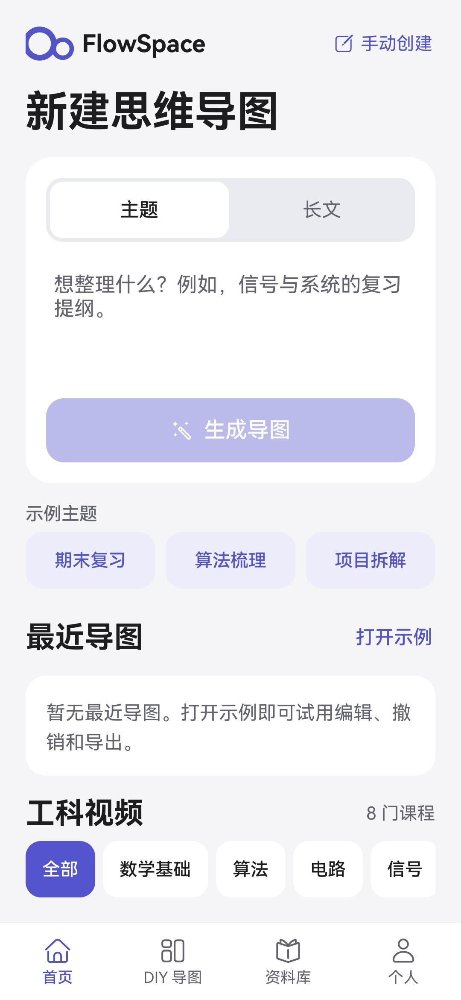
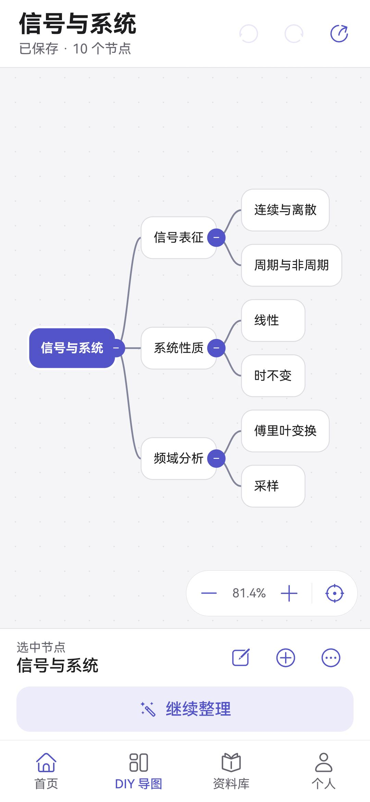
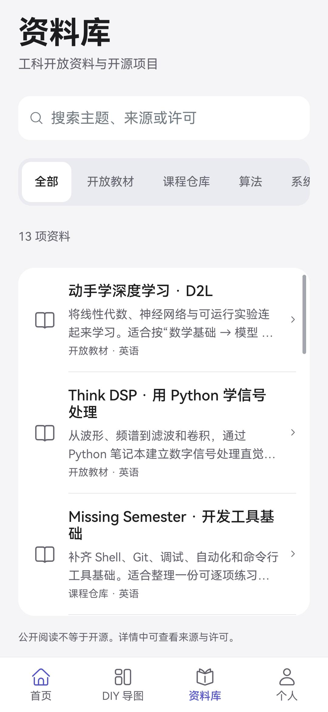
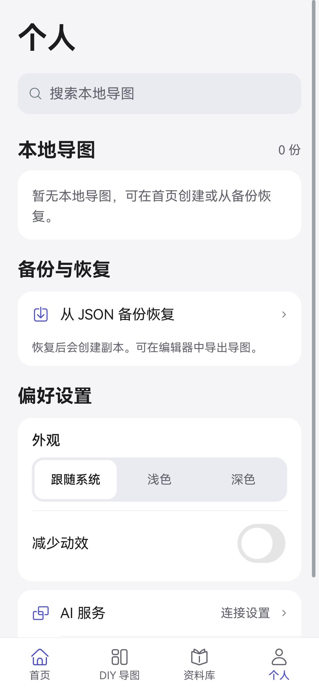

# FlowSpace 原生手机界面

这组图片取自 2026 年 11 月 19 日的鸿蒙 API 24 SDK Previewer。原生入口是 `pages/Index`，标准画面为 1080 × 2340 像素，对应 360 × 780 vp。截图保留实际渲染比例。打开详情图可查看文字与触控区域。

| 首页 · 赵紫石 | DIY 导图 · 黄崇杰 | 资料库 · 陈珂睿 | 个人 · 白长林 |
| --- | --- | --- | --- |
|  |  |  |  |
| [工科视频列表](home-videos.jpg) | [选中分支后打开对话](diy-chat.jpg) | [D2L 的来源和许可](library-detail.jpg) | [后端连接设置](connection.jpg) |

首页点“打开示例”后进入包含十个节点的“信号与系统”。在画布中点击“信号表征”，打开“继续整理”，面板显示当前修改范围。资料页可从列表打开 D2L 详情，个人页可展开 AI 服务连接设置。手机安装、键盘弹出、真实模型和系统文件选择器的验证步骤见 [真机说明](../implementation/phone-testing.md)。

[320 × 640 vp 小屏首页](home-small.jpg) · [深色画布](diy-dark.jpg) · [飞书计划与逐页微调说明](https://nankai.feishu.cn/wiki/NVVxw1k9Sifu0okTLslcz0dRnbh)

> 2026-11-23：DIY 画布已改为“克制层级”视觉（选中分支整条高亮、一级节点细描边、折叠徽标显示隐藏数量、底部单行工具栏），并新增 2D / 3D 切换；3D 支持根节点居中、单指球形旋转、双指平移/缩放和复位视角。本目录现有 `diy*.jpg` 是调整前的原生预览，不能代表新视觉；候选确认、键盘弹出和真机手势截图仍待 SDK/设备补拍，详见 [DIY 设计说明](../implementation/diy-design.md)。[2D/3D 对照图](../design/README.md)由预览页面生成，不是原生截图。
